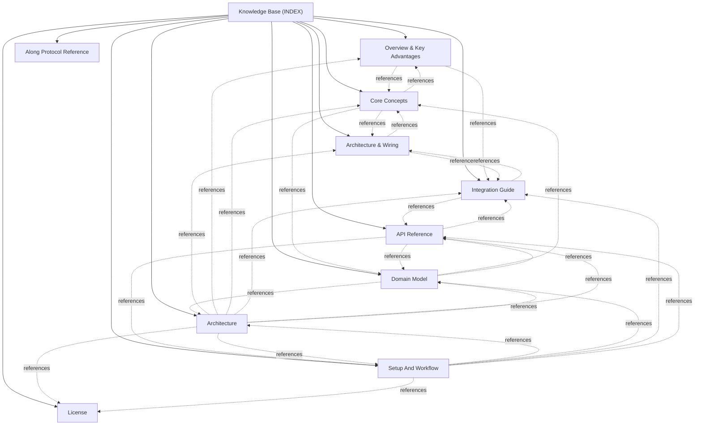

# @actdim/msgmesh-remote - Knowledge Base Topic Index

Central entry point and cross-linked topic catalog for project documentation:

## Knowledge Graph & Topic Map

---

## Articles

- **[Overview & Key Advantages](./topic--01-overview-and-advantages.md)** (topic) `01-overview-and-advantages`, `overview`, `websocket`, `transport`
- **[Core Concepts](./topic--02-core-concepts.md)** (topic) `02-core-concepts`, `frames`, `addressing`, `heartbeat`, `reconnect`, `auth`
- **[Architecture & Wiring](./topic--03-architecture-and-wiring.md)** (topic) `03-architecture-and-wiring`, `sequence`, `bridge`, `session`, `rpc`, `pubsub`
- **[Integration Guide](./topic--04-integration-guide.md)** (topic) `04-integration-guide`, `install`, `fastify`, `websocket`, `bridge`, `testing`
- **[API Reference](./topic--05-api-reference.md)** (topic) `05-api-reference`, `api`, `client`, `server`, `protocol`, `types`
- **[Along Protocol Reference](./topic--along-protocol.md)** (reference) `protocol`, `agents-md`, `checklist`, `routing`, `concurrency`, `along-team`, `conventions`
- **[Architecture](./topic--architecture.md)** (topic) `architecture`
- **[Domain Model](./topic--domain-model.md)** (topic) `domain-model`, `frames`, `protocol`, `contracts`
- **[License](./topic--license.md)** (license) `license`, `mit`
- **[Setup And Workflow](./topic--setup-and-workflow.md)** (topic) `setup-and-workflow`, `build`, `test`, `docs`, `monorepo`

---

## Related Context

- [AGENTS.md](../AGENTS.md): Active protocol conventions and rules.
- [Decisions (ADRs)](./decisions/INDEX.md): Architectural Decision Records.
- [Domain Model & Entity Ecosystem](./topic--domain-model.md): Specifications for active issues and project history.
