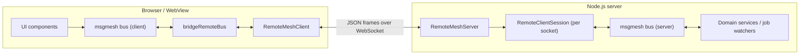

# Overview & Key Advantages

[<- Back to README](../README.md) | [Next: 02. Core Concepts ->](./topic--02-core-concepts.md)

---

## What is @actdim/msgmesh-remote?

**`@actdim/msgmesh-remote`** extends an in-process [`@actdim/msgmesh`](https://actdim.github.io/msgmesh/) bus across a network boundary. A browser (or WebView) bus and a server bus exchange the same `{ channel, group, topic, payload }` messages over one duplex socket, using a small JSON frame protocol.

The package has three parts, each published as its own entry point:

- **Protocol** (`@actdim/msgmesh-remote/protocol`) - the frame vocabulary (`SUB`, `UNSUB`, `MSG`, `REQ`, `RES`, `PING`, `PONG`, `AUTH`, `AUTH_OK`, `AUTH_FAIL`), a validating JSON codec (`JsonFrameCodec`, `defaultCodec`) and frame factory functions.
- **Client** (`@actdim/msgmesh-remote/client`) - `RemoteMeshClient`, a resilient connection with heartbeat, exponential reconnect, subscription replay, an offline send queue and correlated RPC; plus `bridgeRemoteBus` to wire it into a local bus declaratively.
- **Server** (`@actdim/msgmesh-remote/server`) - `RemoteMeshServer`, a framework-agnostic session manager that maps client frames onto a server-side bus, with hooks for authentication, authorization, channel resolution and per-session event filtering.

The root entry point (`@actdim/msgmesh-remote`) re-exports all three plus the shared type contracts.

---

## Where It Fits

UI code keeps talking only to its local bus. Remote delivery, reconnects and authentication are concerns of the transport layer, not of components.

---

## Key Advantages

### 1. One Messaging Model End to End
- Frames carry the same `channel` / `group` / `topic` addressing that `@actdim/msgmesh` uses in-process, so a server event can land on the client bus unchanged and be consumed with a normal `bus.on(...)`.
- RPC across the wire is a plain `client.request(channel, payload)` on the client and a plain `bus.request(...)` provider on the server.

### 2. Transport Agnostic
- The server depends only on the duck-typed `RemoteSocket` contract (`send`, `on('message' | 'close' | 'error')`, `close`). A `ws` socket from `@fastify/websocket` satisfies it directly; so does an in-memory socket pair in tests.
- The client accepts a URL (string or getter) for the global `WebSocket`, or a `socketFactory` returning either a DOM-style `WebSocket` or any `RemoteSocket`.
- Serialization is pluggable through the `FrameCodec` interface.

### 3. Built for Flaky Mobile Connections
- Client heartbeat: a `PING` every 15 s (`heartbeatIntervalMs`) and a 5 s `PONG` deadline (`heartbeatTimeoutMs`); a missed `PONG` terminates the half-open socket and reconnects. This targets WebViews (.NET MAUI, iOS WKWebView, Android WebView) where a suspended app can leave a socket silently dead.
- Reconnect with exponential backoff (factor 1.5, 500 ms -> 10 s by default) and +/-20% jitter.
- Subscriptions are kept in a registry and replayed after every reconnect; fire-and-forget sends made while offline are buffered (200 frames by default) and flushed in order.

### 4. Security Hooks at the Session Boundary
- Handshake context (`handleConnection(socket, { userId, metadata })`) plus in-band `AUTH` frames for login and token refresh without reconnecting (`client.authenticate(token)`).
- `authorize(context, frame)` gates every non-`AUTH` frame; a denied `REQ` gets a `403` error response.
- Per-session event filtering (`filterEvent`), with a built-in default that drops events whose payload `userId` / `ownerUserId` belongs to another user.

### 5. Small, Dependency-Light
- Runtime code is five source files; `@actdim/msgmesh` and `rxjs` are peer dependencies only. The client and server talk to "bus-like" structural interfaces (`RemoteBusLike`, `RemoteServerBusLike`), so a msgmesh bus fits without adapters and tests can pass plain object mocks.

---

## Real-World Usage (mempart)

Inside the mempart monorepo the package connects the web app to the Fastify server:

- **Server**: `apps/server/src/controllers/ws/wsController.ts` creates a `RemoteMeshServer<ServerChannel, 'in'>` over the server bus, registers it on `/api/v1/ws` and `/ws`, verifies tokens in `onAuthenticate`, starts job watching from `authorize` when a client subscribes to `JOBS.STATUS`, and enforces tenant isolation in `filterEvent`.
- **Client**: `apps/webapp/src/config/remoteClient.ts` creates a `RemoteMeshClient` with a `tokenGetter` that asks the app bus for the current access token, bridges it to the app bus with `bridgeRemoteBus` (`WORKS.INTAKE.*`, `FEED.EXCHANGE.*`, `JOBS.STATUS`, `VFS.DRIVE.SYNC_STATUS`, `VFS.NODE.*`), and re-authenticates on `APP.SECURITY.AUTH.SIGNIN`.

See [04. Integration Guide](./topic--04-integration-guide.md) for the full wiring.

---

[<- Back to README](../README.md) | [Next: 02. Core Concepts ->](./topic--02-core-concepts.md)
