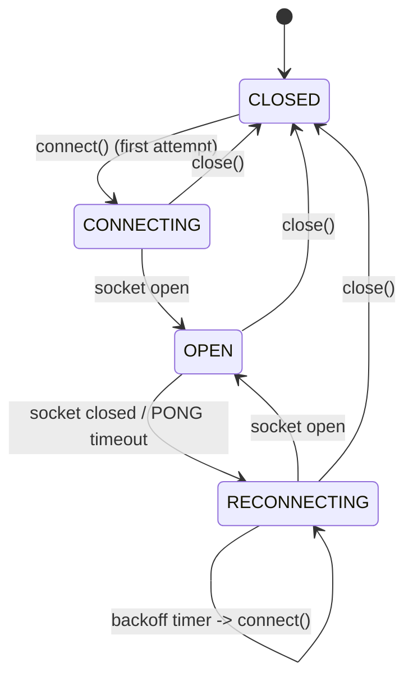

# Core Concepts

[<- Back to 01. Overview](./topic--01-overview-and-advantages.md) | [Next: 03. Architecture & Wiring ->](./topic--03-architecture-and-wiring.md)

---

## 1. Addressing: Channel, Group, Topic

`@actdim/msgmesh` addresses every message by **channel** (for example `JOBS.STATUS`), **group** (`in`, `out`, `ex`, ... - the payload role; msgmesh defaults to `in`) and optional **topic** (a sub-stream key such as a job id). The remote protocol carries exactly these three fields on `SUB`, `UNSUB`, `MSG` and `REQ` frames, so a frame maps one-to-one onto a bus call:

| Frame field | Bus field | Notes |
|---|---|---|
| `channel` | `channel` | Required, non-empty string |
| `group` | `group` | Optional; omitted means the bus default group |
| `topic` | `topic` | Optional; `'*'` in a `SUB` means "every topic" |
| `payload` | `payload` | Optional; any JSON-serializable value |

### Wildcards in subscriptions

A client subscription is a `{ channel, topic?, group? }` triple. The server matches incoming bus events against it with `RemoteClientSession.isSubscribed(channel, topic?, group?)`:

- **Channel**: `'*'` matches everything; a trailing `*` is a prefix match (`'WORKS.INTAKE.*'` matches `WORKS.INTAKE.COMPLETED`); anything else is exact.
- **Topic / group**: missing or `'*'` matches any value; anything else is exact.

The server must also *listen* on concrete bus channels. A msgmesh bus has no channel wildcards, so a prefix subscription needs `RemoteServerOptions.resolveChannels(pattern)` to expand the pattern into the list of real channels (see "Server subscription pipeline" in [03. Architecture & Wiring](./topic--03-architecture-and-wiring.md)).

---

## 2. Frames

All traffic is a stream of frames discriminated by the `t` field. Shapes are defined in `src/types.ts` and validated by `validateFrame` in `src/protocol.ts`.

| `t` | Direction | Purpose | Required fields |
|---|---|---|---|
| `SUB` | client -> server | Start receiving events for an address | `channel` |
| `UNSUB` | client -> server | Stop receiving events for an address | `channel` |
| `MSG` | both | Fire-and-forget message / event | `channel` |
| `REQ` | client -> server | Correlated RPC request | `id`, `channel` |
| `RES` | server -> client | RPC response (`payload` or `error`) | `id` |
| `PING` | both | Heartbeat probe | - |
| `PONG` | both | Heartbeat answer | - |
| `AUTH` | client -> server | Authenticate or refresh the token in-band | `token` (non-empty) |
| `AUTH_OK` | server -> client | Authentication accepted (optional `userId`) | - |
| `AUTH_FAIL` | server -> client | Authentication rejected (optional `code`) | `error` (non-empty) |

The full field-level contract is in [Domain Model](./topic--domain-model.md).

### Codec

A `FrameCodec` turns frames into wire data and back:

```typescript
export interface FrameCodec {
    encode(frame: RemoteFrame): string | Uint8Array;
    decode(raw: string | Uint8Array): RemoteFrame;
}
```

`JsonFrameCodec` (exported singleton: `defaultCodec`) encodes with `JSON.stringify`, decodes strings or `Uint8Array` (UTF-8 via `TextDecoder`), and validates the result. Bad JSON raises `FrameDecodeError`; a structurally invalid frame raises `InvalidFrameError`. Both the client and the server log decode failures and drop the frame instead of closing the connection.

---

## 3. The Bus-Like Contracts

Neither side imports the msgmesh runtime. They depend on structural interfaces that a msgmesh `MsgBus` already satisfies:

- **`RemoteServerBusLike`** (server side): optional `send(msg)`, `request(msg)` and `on({ channel, group?, topic?, options?: { abortSignal }, callback })`.
- **`RemoteBusLike`** (client side): everything above plus optional `provide({ channel, group?, callback })`.

Every method is optional; the code checks `typeof bus.x === 'function'` before calling. Missing `request` on the server produces an error `RES` (`'Server bus has no request provider'`); missing `send` or `on` turns the corresponding feature into a no-op.

---

## 4. Client Connection Lifecycle

`RemoteMeshClient` is a small state machine exposed through `getState()` and `onStateChange(listener)`:



On every transition to `OPEN` the client, in order:

1. resets the reconnect attempt counter and starts the heartbeat;
2. sends an `AUTH` frame if `options.token` or `await options.tokenGetter()` yields a token;
3. replays a `SUB` frame for every registered subscription;
4. flushes the offline queue.

The automatic `AUTH` on open is fire-and-forget: frames sent in steps 3-4 do not wait for `AUTH_OK`. Use the server's handshake context or `authorize` if early frames must already be authenticated.

### Socket flavours

- **DOM-style `WebSocket`** (has `addEventListener`): the client waits for the `open` event and unwraps `MessageEvent.data`.
- **`RemoteSocket`** (has `on`): the socket is treated as already open, and the open sequence runs immediately.

### Heartbeat

While `OPEN`, the client sends `PING` every `heartbeatIntervalMs` (default `15000`) and arms a `heartbeatTimeoutMs` timer (default `5000`). A `PONG` clears the timer; otherwise the client closes the socket and schedules a reconnect. The client also answers server `PING` frames with `PONG`. The server answers `PING` but never originates one.

### Reconnect backoff

```text
delay = min(minReconnectDelayMs * 1.5^(attempt - 1), maxReconnectDelayMs) * random(0.8 .. 1.2)
```

Defaults: `minReconnectDelayMs = 500`, `maxReconnectDelayMs = 10000`. Only an explicit `close()` stops reconnecting. A `url` given as a function is re-evaluated on each attempt, so it can embed a fresh token or host.

---

## 5. Subscriptions, Offline Queue and Requests

| Operation | While `OPEN` | While not `OPEN` |
|---|---|---|
| `subscribe(channel, topic?, group?)` | Registered and `SUB` sent | Registered; `SUB` sent on next open |
| `unsubscribe(channel, topic?, group?)` | Removed and `UNSUB` sent | Removed from the registry only |
| `send(channel, payload?, topic?, group?)` | `MSG` sent | Queued (FIFO, up to `maxOfflineQueueSize`, default `200`; overflow is dropped with a warning) |
| `request(channel, payload?, { topic?, group?, timeout? })` | `REQ` sent, awaits `RES` | Registered but **not sent and not queued**; rejects on timeout |

Subscription identity is the key `channel::group::topic`, so subscribing twice to the same address is idempotent.

`request()` generates an id (`req-<random>-<time>`), rejects with `Request timeout after <ms>ms` after `options.timeout ?? defaultRequestTimeoutMs ?? 10000`, resolves with `RES.payload`, and rejects with the raw `RES.error` value when the server reports an error. `close()` rejects every pending request and pending authentication with `Client connection closed` and clears the offline queue.

---

## 6. Authentication

Two mechanisms coexist:

- **Handshake context**: the host verifies credentials during the WebSocket upgrade (query string, header, cookie) and passes `{ userId, metadata }` to `server.handleConnection(socket, context)`.
- **In-band `AUTH`**: the client sends `AUTH` (automatically on open, or explicitly via `authenticate(token, timeoutMs = 10000)`). The server calls `onAuthenticate(token, context)`:

| `onAuthenticate` result | Server reply | Session effect |
|---|---|---|
| hook not configured | `AUTH_OK` with current `userId` | none |
| falsy (`null`, `false`) | `AUTH_FAIL` `'Authentication failed'`, code `401` | none |
| `true` | `AUTH_OK` with current `userId` | none |
| `{ userId?, metadata? }` | `AUTH_OK` with resulting `userId` | `userId` replaced, `metadata` shallow-merged |
| throws | `AUTH_FAIL` with the error message, code `500` | none |

`authenticate()` resolves on `AUTH_OK` and rejects on `AUTH_FAIL` or timeout; a newer call supersedes a pending one. It rejects immediately if the client is not `OPEN`.

---

## 7. Authorization and Event Filtering

- **`authorize(context, frame)`** runs for every inbound frame except `AUTH` (including `PING`). If it returns `false`, the frame is dropped; a denied `REQ` receives `RES` with `error: { message: 'Unauthorized', code: 403 }`.
- **`filterEvent(context, channel, payload, topic?, group?)`** decides per session whether a bus event is forwarded. Without it, the default filter drops an event when the payload has `userId` or `ownerUserId`, the session has a `userId`, and the two differ (compared as strings). Sessions without a `userId` receive everything under the default filter.
- **`server.broadcast(...)`** pushes directly to subscribed sessions and does not run `filterEvent`.

---

[<- Back to 01. Overview](./topic--01-overview-and-advantages.md) | [Next: 03. Architecture & Wiring ->](./topic--03-architecture-and-wiring.md)
