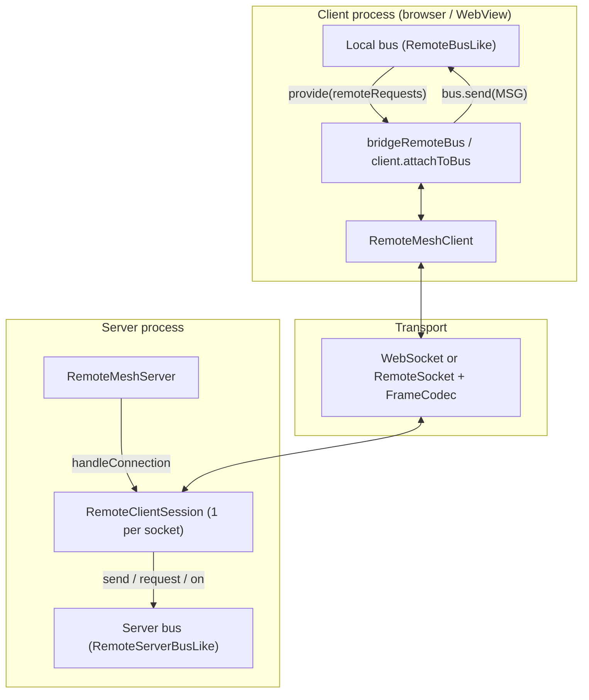
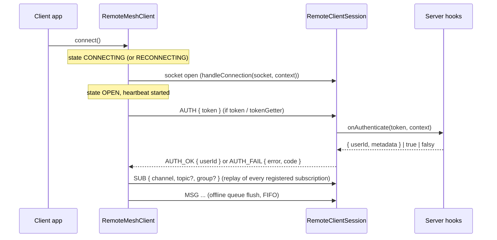
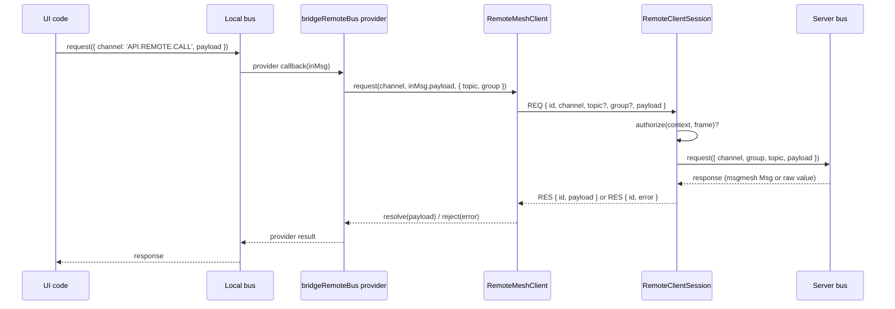
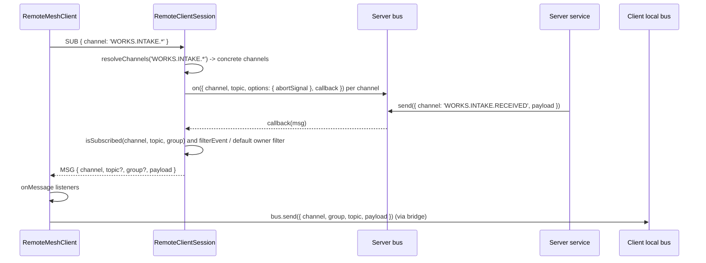
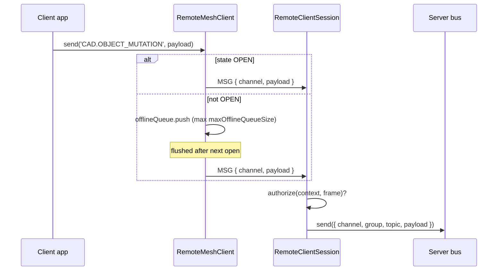
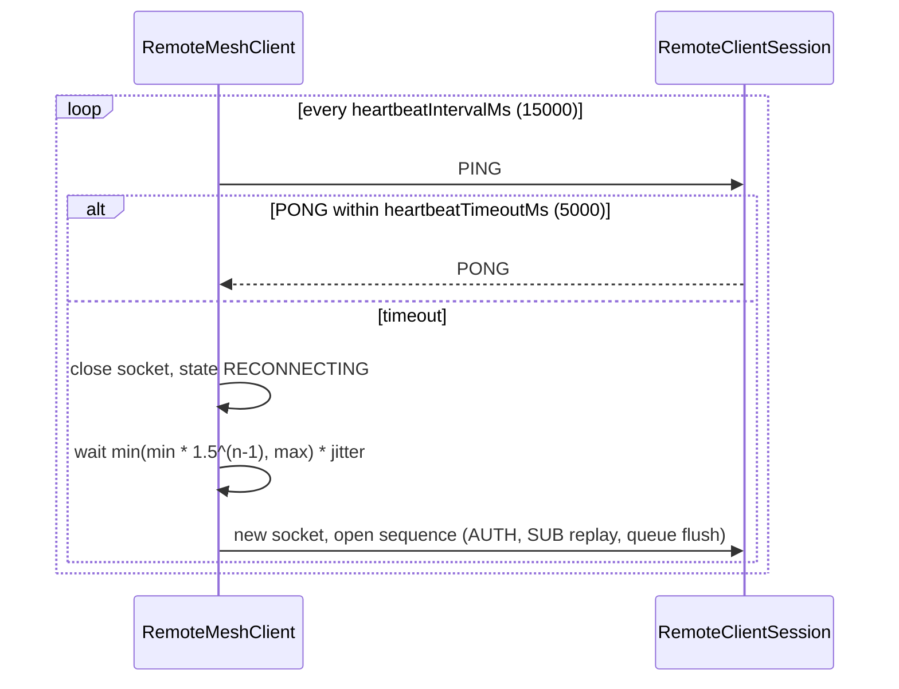

# Architecture & Wiring

[<- Back to 02. Core Concepts](./topic--02-core-concepts.md) | [Next: 04. Integration Guide ->](./topic--04-integration-guide.md)

---

## 1. Component Map

| Unit | File | Responsibility |
|---|---|---|
| Frame types, socket and bus contracts | `src/types.ts` | Pure type declarations |
| Codec, validation, frame factories | `src/protocol.ts` | `JsonFrameCodec`, `validateFrame`, `create*Frame` |
| `RemoteMeshServer`, `RemoteClientSession` | `src/server.ts` | Session registry, frame dispatch, bus listeners, auth hooks |
| `RemoteMeshClient`, `bridgeRemoteBus` | `src/client.ts` | Connection state, heartbeat, reconnect, queue, RPC, bus bridge |

---

## 2. Connection Open, Auth and Resubscribe

`AUTH`, `SUB` and the queued `MSG` frames are written back to back. On the server each frame is dispatched as `void session.handleFrame(frame)`, so an `onAuthenticate` that awaits I/O can still be running when the following `SUB` frames are processed.

---

## 3. Remote RPC (client -> server)

- Only channels listed in `RemoteBusBridgeConfig.remoteRequests` (array form) get a local `provide()` registration. The topic and group are taken from `inMsg.address` (falling back to `inMsg.topic` / `inMsg.group`).
- On the server, a response object that has a `payload` property (a msgmesh response message) is unwrapped to that `payload`; any other value is sent as-is.
- A thrown error becomes `RES.error`: for an `Error` instance `{ message, name, ...ownEnumerableProps }`, for another object its own enumerable props, otherwise `{ message: String(err) }`.
- `client.request()` can also be called directly without the bridge.

---

## 4. Server Events to the Client (pub/sub)

### Server subscription pipeline

For a `SUB` frame, `RemoteClientSession`:

1. Stores the subscription under `channel::group::topic`.
2. Computes the bus channels to listen on: `resolveChannels(frame.channel)` if configured, otherwise `[frame.channel]` verbatim.
3. For each bus channel not yet listened on (keyed by `busChannel::topic`), calls `bus.on({ channel, topic, options: { abortSignal }, callback })`. A topic of `'*'` is translated to the msgmesh regex topic `'/.*/'`. No `group` is passed, so a msgmesh bus listens on its default group (`in`), which is also the group `bus.send` uses when none is given.
4. In the callback, reads `channel` / `topic` / `group` from `msg.address` (or top-level fields), takes `msg.payload` (or the whole message if there is none), re-checks `isSubscribed`, applies `filterEvent` (or the default owner filter) and sends a `MSG` frame.

Two consequences for a msgmesh server bus:

- **Channel wildcards need `resolveChannels`.** Without it, `SUB 'WORKS.INTAKE.*'` makes the session listen on a bus channel literally named `WORKS.INTAKE.*`.
- **Topic-less subscriptions only see topic-less events.** msgmesh matches an undefined listener topic only against messages without a topic, so to receive `JOBS.STATUS` events published with `topic: jobId`, subscribe with that topic (or with `'*'`).

`UNSUB` removes the stored subscription and aborts a bus listener only when no remaining subscription resolves to the same bus channel and topic. Closing the socket (`close` or `error` event) calls `session.close()`, which aborts every bus listener and removes the session from the server.

### Server-initiated pushes

`server.broadcast(channel, payload?, topic?, group?)` sends a `MSG` to every session whose subscriptions match, independent of the server bus.

---

## 5. Client Messages to the Server (fire-and-forget)

---

## 6. Heartbeat and Reconnect

---

## 7. Declarative Bridge

`bridgeRemoteBus(bus, client, config)` (or `client.attachToBus(bus, config)`) wires three things and returns one disposer:

| Config field | Effect |
|---|---|
| `remoteSubscriptions: RemoteSubscriptionItem[]` | `client.subscribe(...)` for each item now; `client.unsubscribe(...)` on dispose |
| `remoteRequests: TChannel[]` | `bus.provide({ channel, callback })` forwarding to `client.request(...)`; provider disposed on dispose |
| *(always)* | `client.onMessage` -> `bus.send({ channel, group, topic, payload })` for every incoming `MSG` |

`RemoteBusBridgeConfig` also declares `remoteRequests` as a predicate function and a `sendToRemote` field; neither is acted on by `bridgeRemoteBus` in the current source (only the array form of `remoteRequests` registers providers, and local-to-remote forwarding is done by calling `client.send` yourself).

---

[<- Back to 02. Core Concepts](./topic--02-core-concepts.md) | [Next: 04. Integration Guide ->](./topic--04-integration-guide.md)
